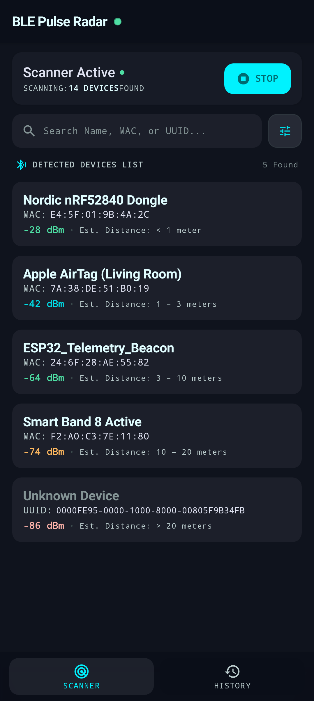
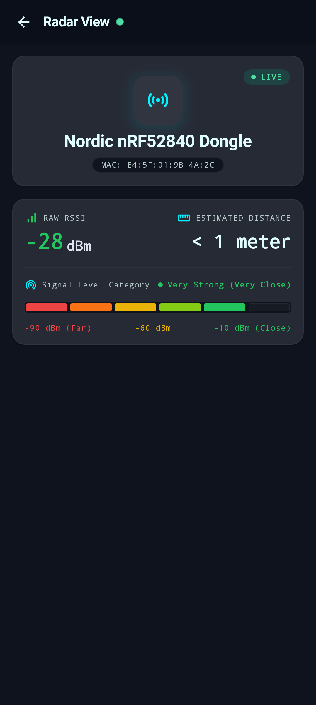
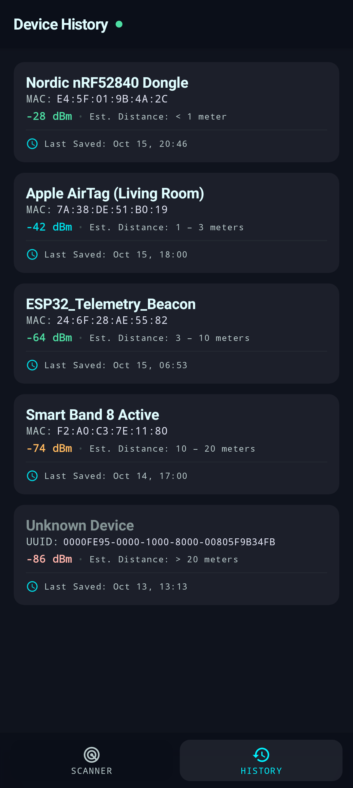
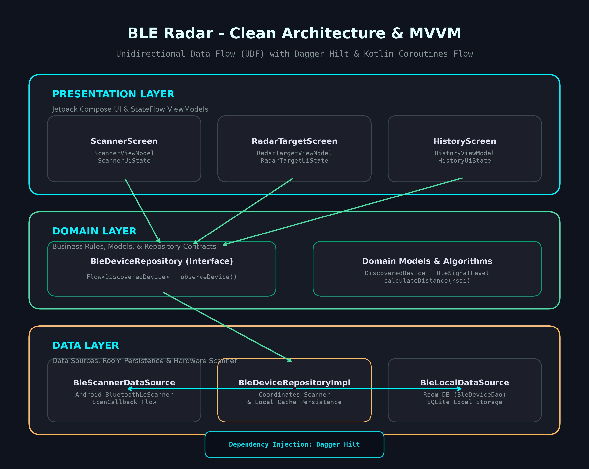

# BLE Radar

## 1. Summary

**BLE Radar** is an Android application designed to scan, detect, and track Bluetooth Low Energy (BLE) peripheral devices in real time with intuitive signal strength telemetry and estimated physical proximity.

The application provides continuous BLE discovery, distance estimation categorized by signal strength (dBm), interactive search and signal filtering, persistent device logging using Room database, and target-locked live radar tracking, with a focus on performance, scalability, maintainability, and user experience.

## 2. Screenshots

| Home | Detail | Profile |
|:----:|:------:|:-------:|
|  |  |  |

## 3. Features

- **Continuous BLE Scanning & Discovery** — Actively scans for nearby Bluetooth Low Energy peripherals with live RSSI signal telemetry, broadcast packet parsing, and automatic MAC-based deduplication.
- **Calibrated Proximity & Distance Estimation** — Accurately estimates physical distance based on calibrated dBm thresholds:
  - `-10 dBm to -30 dBm`: Very Strong / Very Close (`< 1 meter`)
  - `-30 dBm to -50 dBm`: Strong / Close (`1 – 3 meters`)
  - `-50 dBm to -70 dBm`: Moderate / Fair (`3 – 10 meters`)
  - `-70 dBm to -80 dBm`: Weak (`10 – 20 meters`)
  - `-80 dBm to -90 dBm`: Very Weak / Outskirts (`> 20 meters`)
  - `< -90 dBm`: Signal Lost / Out of Range (`Disconnected`)
- **Intensive Radar Target Tracking** — Locks onto any selected peripheral with continuous discovery bound to the screen's lifecycle (`ON_START` / `ON_STOP`), pulsating live beacon animation, real-time RSSI updates, and a 6-segment calibrated distance bar.
- **Local Persistence & Device History** — Persists unique discovered devices into an offline Room SQLite database, presenting historical logs with last-saved timestamp formatting.
- **Search & Signal Filtering** — Live search by device name, MAC address, or UUID, combined with a modal bottom sheet filter for specific signal strength levels.
- **Reusable Component Architecture** — Unified `BleDeviceCard` and `BleRadarBottomNavBar` components shared between Scanner and History screens without code duplication.

## 4. Tech Stack

| Category | Technology |
|----------|------------|
| Language | Kotlin (2.2.10) |
| UI | Jetpack Compose (Material 3) |
| Architecture | MVVM + Clean Architecture |
| Dependency Injection | Dagger Hilt (2.60.1) |
| Asynchronous | Kotlin Coroutines & Flow |
| Local Storage | Room Database (2.8.4) with SQLite |
| Navigation | Jetpack Navigation 3 (NavKey & NavDisplay) |
| Testing | JUnit 4, Robolectric, Kotlinx Coroutines Test |
| Screenshot Testing | Roborazzi (Native Graphics Mode) |
| Serialization | Kotlinx Serialization JSON |
| Build System | Gradle Kotlin DSL (8.13.0) with KSP |

## 5. Architecture

The project follows Clean Architecture and MVVM (Model-View-ViewModel) design principles to separate responsibilities, enforce unidirectional data flow (UDF), and maximize testability and maintainability.

### Architecture Overview

The project follows Clean Architecture principles to separate responsibilities and improve testability and maintainability.

### Layers

- **Presentation Layer**
  Handles UI components, UI state, and user interactions. Built with Jetpack Compose Material 3 (`ScannerScreen`, `RadarTargetScreen`, `HistoryScreen`, `BleDeviceCard`, `BleRadarBottomNavBar`) backed by Hilt ViewModels emitting immutable `StateFlow<UiState>`.

- **Domain Layer**
  Contains core business logic, domain models (`DiscoveredDevice`, `BleSignalLevel`), distance calculation rules, and repository contracts (`BleDeviceRepository`).

- **Data Layer**
  Manages data sources and repository implementations:
  - `BleScannerDataSource`: Wraps Android `BluetoothLeScanner` and emits reactive discovery flows.
  - `BleLocalDataSource`: Room database (`BleDatabase`, `BleDeviceDao`, `BleDeviceEntity`) persisting devices uniquely by MAC address.
  - `BleDeviceRepositoryImpl`: Coordinates hardware scanning and Room caching.

### Architecture Diagram



## 6. Project Structure

Example multi-module and package organization:

```text
ble-radar/
├── app/
│   ├── src/
│   │   ├── main/
│   │   │   ├── java/com/example/ble_radar/
│   │   │   │   ├── BleRadarApplication.kt    # Application class with @HiltAndroidApp
│   │   │   │   ├── MainActivity.kt           # Single Activity with @AndroidEntryPoint
│   │   │   │   ├── Navigation.kt             # Compose NavDisplay backstack routing
│   │   │   │   ├── NavigationKeys.kt         # Type-safe @Serializable NavKeys
│   │   │   │   ├── data/
│   │   │   │   │   ├── local/                # Room DB, Entity, DAO, LocalDataSource
│   │   │   │   │   ├── model/                # DiscoveredDevice, BleSignalLevel
│   │   │   │   │   ├── repository/           # BleDeviceRepository & implementation
│   │   │   │   │   └── scanner/              # Android BLE Scanner DataSource
│   │   │   │   ├── di/                       # DatabaseModule & RepositoryModule
│   │   │   │   ├── theme/                    # Color, Type, and Theme definitions
│   │   │   │   └── ui/
│   │   │   │       ├── components/           # Reusable BleDeviceCard & BleRadarBottomNavBar
│   │   │   │       ├── history/              # HistoryScreen, HistoryViewModel, UiState
│   │   │   │       ├── scanner/              # ScannerScreen, FilterSheet, ViewModel, UiState
│   │   │   │       └── target/               # RadarTargetScreen, ViewModel, UiState
│   │   │   └── res/
│   │   │       └── values/strings.xml        # Localized string resources
│   │   └── test/                             # Unit tests & Roborazzi snapshot tests
│   └── build.gradle.kts                      # App module build configuration
├── docs/
│   └── architecture.png                      # Clean architecture diagram
├── screenshots/
│   ├── home.png                              # Scanner screen screenshot
│   ├── detail.png                            # Radar target tracking screenshot
│   └── profile.png                           # Device history screen screenshot
├── gradle/
│   └── libs.versions.toml                    # Version catalog dependencies
├── build.gradle.kts                          # Root build script
└── README.md
```

## 7. Getting Started

### Prerequisites

- Android Studio Ladybug (2024.2.1) or newer
- Android SDK 35 (compileSdk 36, minSdk 26, targetSdk 35)
- JDK 17 or JDK 21 (compatible with the project's Gradle version)
- Gradle (included through Gradle Wrapper)
- Physical Android device with Bluetooth 4.0+ enabled (recommended) or emulator

### Installation

1. Clone the repository:

```bash
git clone https://github.com/henrasn/BLE-radar.git
```

2. Open the project in Android Studio.

3. Configure the required environment variables or API keys.

4. Sync the project with Gradle.

5. Run the application on an emulator or physical device.

### Build from Command Line

```bash
./gradlew assembleDebug
```

## 8. Configuration

Describe the required application configuration.

The application requires runtime Bluetooth and Location permissions on Android devices:

```properties
Manifest.permission.BLUETOOTH_SCAN
Manifest.permission.BLUETOOTH_CONNECT
Manifest.permission.ACCESS_FINE_LOCATION
Manifest.permission.ACCESS_COARSE_LOCATION
```

Ensure Bluetooth hardware and Location services are enabled in your device settings before starting a scan.

Do not commit credentials, private API keys, or production secrets to the repository.

## 9. Testing

The project implements automated unit testing and visual regression screenshot testing.

### Unit Testing

Runs tests for ViewModels, repository logic, Room DAO persistence, signal/distance classification algorithms, and search filtering:

```bash
./gradlew testDebugUnitTest
```

### Snapshot Verification (Roborazzi)

Verifies Jetpack Compose visual regression snapshot tests against recorded golden images:

```bash
./gradlew verifyRoborazziDebug
```

To record / update golden snapshots:

```bash
./gradlew recordRoborazziDebug
```

### Instrumentation Testing

```bash
./gradlew connectedDebugAndroidTest
```

## 10. Build & Release

Available build variants and the release process:

| Variant | Description |
|---------|-------------|
| Debug | Local development, logging, and Roborazzi snapshot testing |
| Release | Production-ready build with ProGuard/R8 optimization |

### Release Build

```bash
./gradlew assembleRelease
```

## 11. Known Limitations

- **Background Scanning Limits**: Android OS battery optimization and Doze mode restrict continuous BLE scanning in the background without a persistent Foreground Service.
- **RF Path Loss Variance**: Physical obstacles, metallic structures, and antenna orientation can introduce signal multipath fading affecting RSSI readings.
